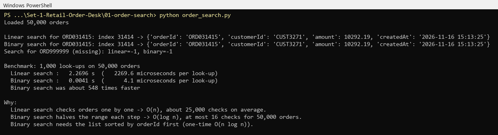
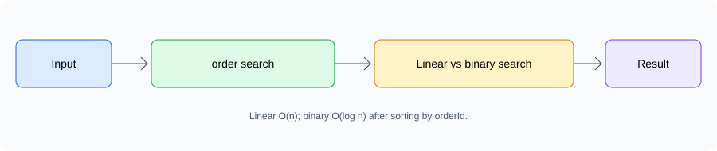

# Question 1 – Order search

**Question:** Load orders.csv (orderId, customerId, amount, createdAt). Implement linear search and binary search to retrieve an order by ID, benchmark both on 50,000 records and explain the observed difference.

## Files

- [order_search.py](order_search.py)
- [output.txt](output.txt) – console output
- [flowchart.svg](flowchart.svg) – steps of the solution

## How to run

```bash
python order_search.py
```

## Output

**python order_search.py**



## Approach



**Complexity:** Linear O(n); binary O(log n) after sorting by orderId.
