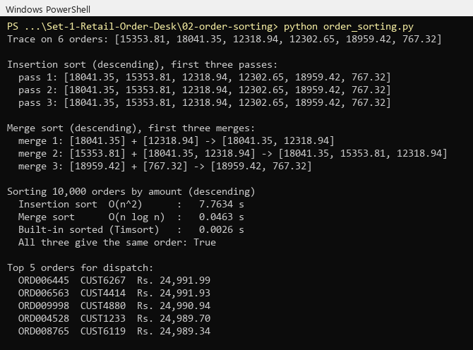
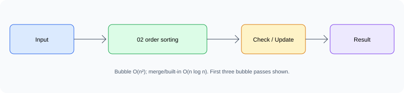

# Question 2 – Order sorting

**Question:** Implement one O(n²) and one O(n log n) sorting algorithm in Python to rank orders by amount (descending). Trace the first three passes on paper and compare both against the built-in sort on 10,000 records.

## Files

- [order_sorting.py](order_sorting.py)
- [output.txt](output.txt) – console output
- [flowchart.svg](flowchart.svg) – steps of the solution

## How to run

```bash
python order_sorting.py
```

## Output

**python order_sorting.py**



## Approach



**Complexity:** Insertion O(n²); merge O(n log n); built-in Timsort is fastest.
