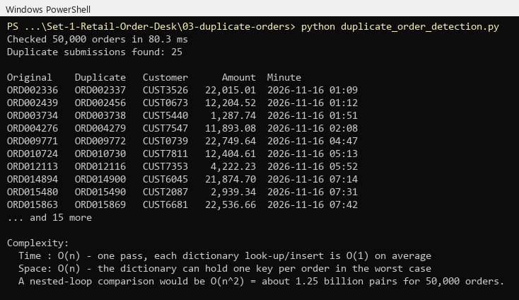
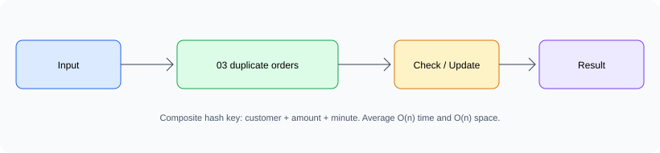

# Question 3 – Duplicate orders

**Question:** Detect duplicate orders (same customerId and amount within the same minute) using a hash-based structure. State the time and space complexity.

## Files

- [duplicate_order_detection.py](duplicate_order_detection.py)
- [output.txt](output.txt) – console output
- [flowchart.svg](flowchart.svg) – steps of the solution

## How to run

```bash
python duplicate_order_detection.py
```

## Output

**python duplicate_order_detection.py**



## Approach



**Complexity:** Dictionary keyed by customer, amount and minute: O(n) time, O(n) space.
