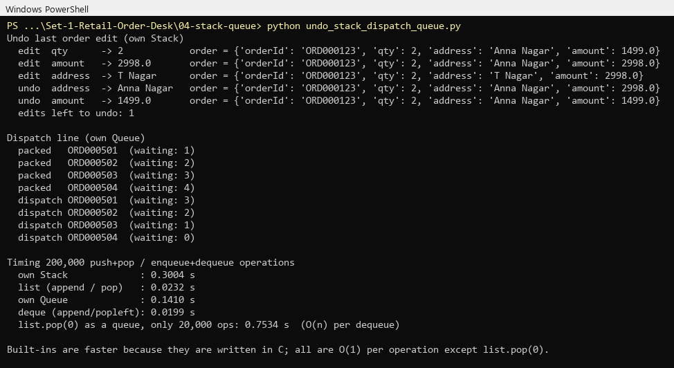
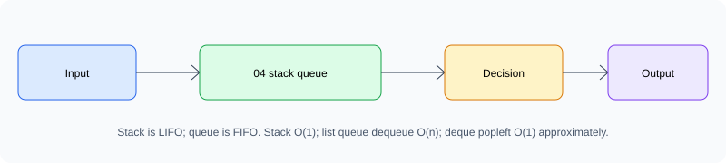

# Question 4 – Stack queue

**Question:** Build your own Stack to support 'undo last order edit' and your own Queue to model the dispatch line; then replace them with the built-in equivalents and compare.

## Files

- [undo_stack_dispatch_queue.py](undo_stack_dispatch_queue.py)
- [output.txt](output.txt) – console output
- [flowchart.svg](flowchart.svg) – steps of the solution

## How to run

```bash
python undo_stack_dispatch_queue.py
```

## Output

**python undo_stack_dispatch_queue.py**



## Approach



**Complexity:** Own linked-list Stack and Queue, O(1) per operation; compared with list and deque.
