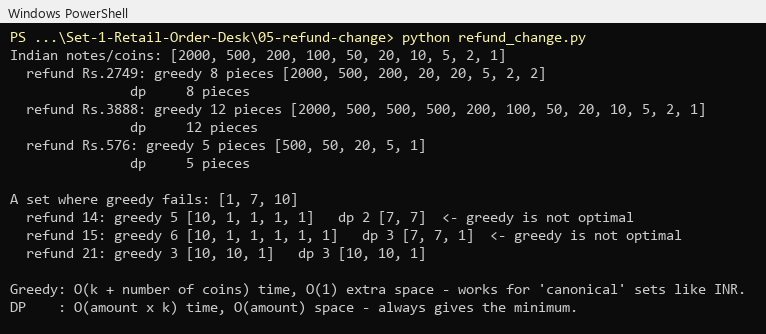

# Question 5 – Refund change

**Question:** Compute the minimum number of notes/coins for a refund amount using a greedy approach. Show one denomination set where greedy fails and solve it with dynamic programming.

## Files

- [refund_change.py](refund_change.py)
- [output.txt](output.txt) – console output
- [flowchart.svg](flowchart.svg) – steps of the solution

## How to run

```bash
python refund_change.py
```

## Output

**python refund_change.py**



## Approach


**Complexity:** Greedy fails for [1, 7, 10] at 14; DP always gives the minimum.
