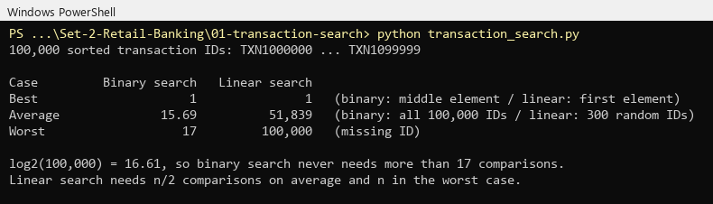
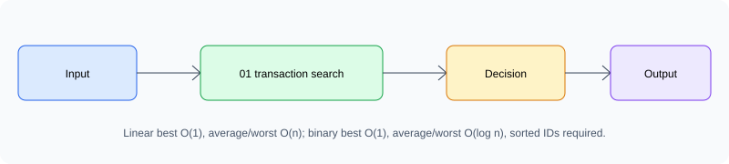

# Question 1 – Transaction search

**Question:** Search a sorted list of 100,000 transaction IDs using binary search; count the number of comparisons for the best, average and worst cases and compare with linear search.

## Files

- [transaction_search.py](transaction_search.py)
- [output.txt](output.txt) – console output
- [flowchart.svg](flowchart.svg) – steps of the solution

## How to run

```bash
python transaction_search.py
```

## Output

**python transaction_search.py**



## Approach



**Complexity:** Binary search needs at most 17 comparisons for 100,000 IDs; linear up to 100,000.
