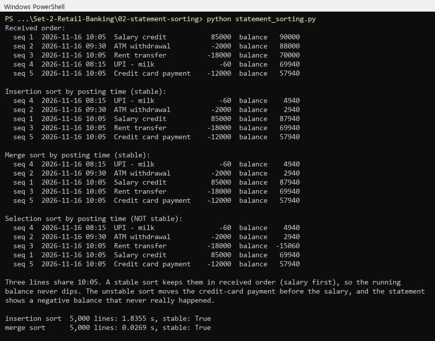

# Question 2 – Statement sorting

**Question:** Sort a customer's statement by posting date using insertion sort and merge sort. Explain stability and show why it matters when two transactions share the same timestamp.

## Files

- [statement_sorting.py](statement_sorting.py)
- [output.txt](output.txt) – console output
- [flowchart.svg](flowchart.svg) – steps of the solution

## How to run

```bash
python statement_sorting.py
```

## Output

**python statement_sorting.py**



## Approach


**Complexity:** Insertion and merge sort are stable, so equal timestamps keep their order.
