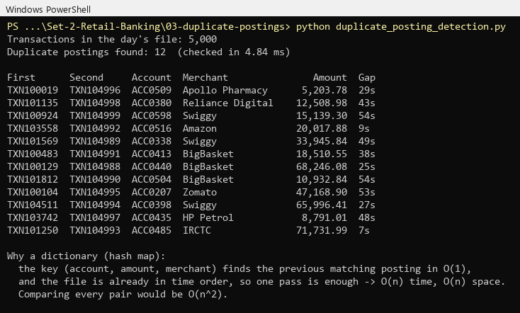
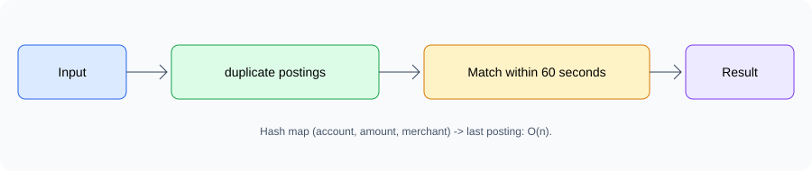

# Question 3 – Duplicate postings

**Question:** Identify duplicate postings (same account, amount and merchant within 60 seconds) and justify the data structure used.

## Files

- [duplicate_posting_detection.py](duplicate_posting_detection.py)
- [output.txt](output.txt) – console output
- [flowchart.svg](flowchart.svg) – steps of the solution

## How to run

```bash
python duplicate_posting_detection.py
```

## Output

**python duplicate_posting_detection.py**



## Approach



**Complexity:** Hash map (account, amount, merchant) -> last posting: O(n).
