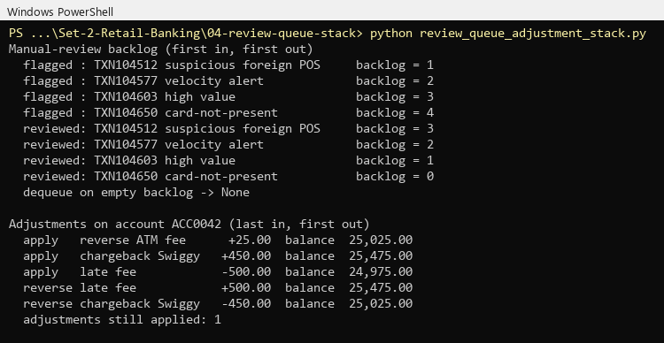
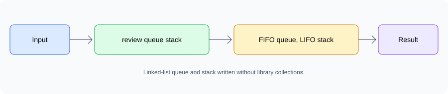

# Question 4 – Review queue stack

**Question:** Use a queue to model the manual-review backlog (first in, first out) and a stack to model 'reverse last adjustment'; implement both without library collections first.

## Files

- [review_queue_adjustment_stack.py](review_queue_adjustment_stack.py)
- [output.txt](output.txt) – console output
- [flowchart.svg](flowchart.svg) – steps of the solution

## How to run

```bash
python review_queue_adjustment_stack.py
```

## Output

**python review_queue_adjustment_stack.py**



## Approach



**Complexity:** Linked-list queue and stack written without library collections.
