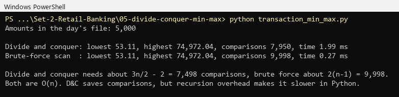
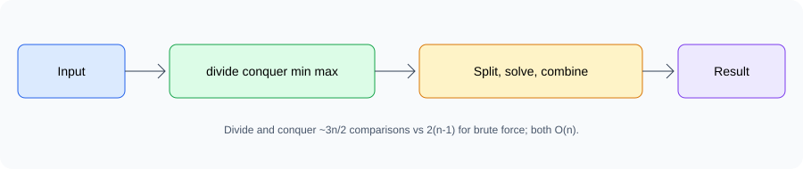

# Question 5 – Divide conquer min max

**Question:** Apply divide-and-conquer to find the highest and lowest transaction amount in a day's file, then compare with a brute-force scan.

## Files

- [transaction_min_max.py](transaction_min_max.py)
- [output.txt](output.txt) – console output
- [flowchart.svg](flowchart.svg) – steps of the solution

## How to run

```bash
python transaction_min_max.py
```

## Output

**python transaction_min_max.py**



## Approach



**Complexity:** Divide and conquer ~3n/2 comparisons vs 2(n-1) for brute force; both O(n).
