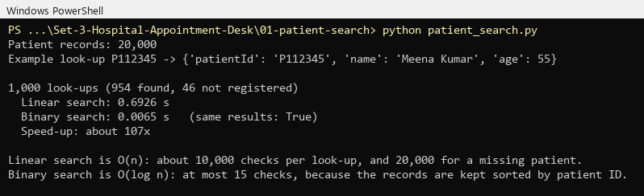
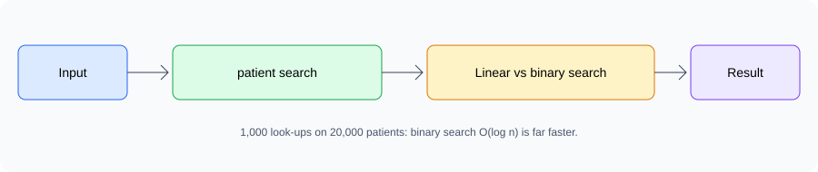

# Question 1 – Patient search

**Question:** Implement linear and binary search over 20,000 patient records keyed by patient ID; measure the time for 1,000 look-ups and explain the result.

## Files

- [patient_search.py](patient_search.py)
- [output.txt](output.txt) – console output
- [flowchart.svg](flowchart.svg) – steps of the solution

## How to run

```bash
python patient_search.py
```

## Output

**python patient_search.py**



## Approach



**Complexity:** 1,000 look-ups on 20,000 patients: binary search O(log n) is far faster.
