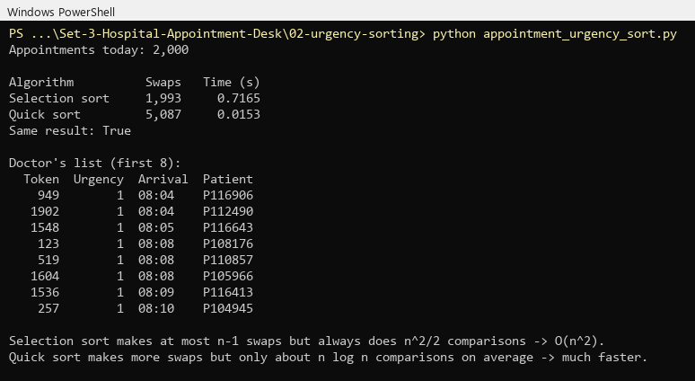
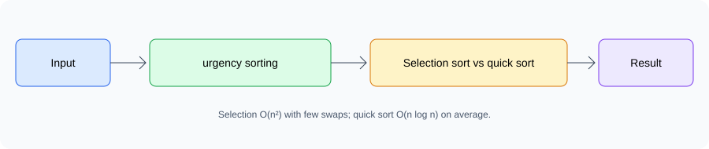

# Question 2 – Urgency sorting

**Question:** Sort the day's appointments by urgency level and then by arrival time using selection sort and quick sort; compare the number of swaps and the running time.

## Files

- [appointment_urgency_sort.py](appointment_urgency_sort.py)
- [output.txt](output.txt) – console output
- [flowchart.svg](flowchart.svg) – steps of the solution

## How to run

```bash
python appointment_urgency_sort.py
```

## Output

**python appointment_urgency_sort.py**



## Approach



**Complexity:** Selection O(n²) with few swaps; quick sort O(n log n) on average.
