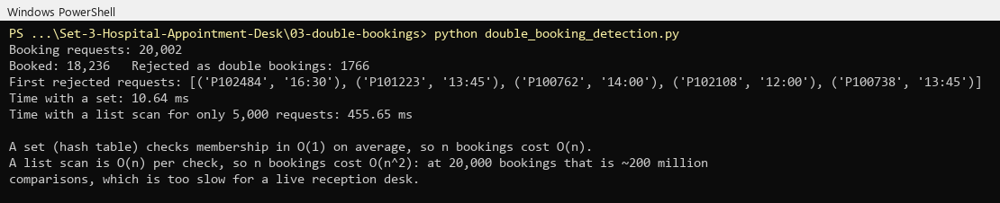
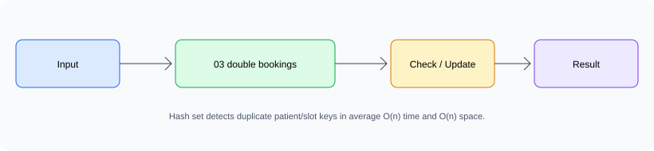

# Question 3 – Double bookings

**Question:** Detect double-booked slots (same patient and slot) with the most suitable data structure and explain why a list scan is not acceptable at this volume.

## Files

- [double_booking_detection.py](double_booking_detection.py)
- [output.txt](output.txt) – console output
- [flowchart.svg](flowchart.svg) – steps of the solution

## How to run

```bash
python double_booking_detection.py
```

## Output

**python double_booking_detection.py**



## Approach



**Complexity:** Set membership is O(1); a list scan makes the whole check O(n²).
