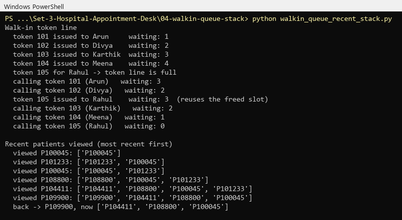
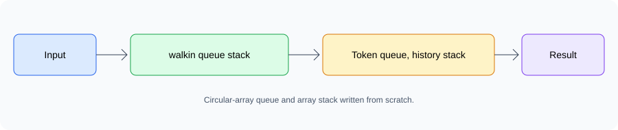

# Question 4 – Walkin queue stack

**Question:** Model the walk-in token line with a Queue and the 'recent patients viewed' history with a Stack, each implemented from scratch.

## Files

- [walkin_queue_recent_stack.py](walkin_queue_recent_stack.py)
- [output.txt](output.txt) – console output
- [flowchart.svg](flowchart.svg) – steps of the solution

## How to run

```bash
python walkin_queue_recent_stack.py
```

## Output

**python walkin_queue_recent_stack.py**



## Approach



**Complexity:** Circular-array queue and array stack written from scratch.
