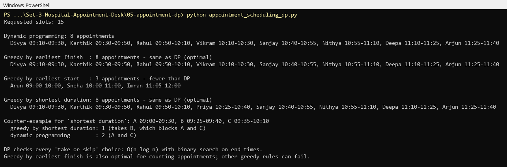
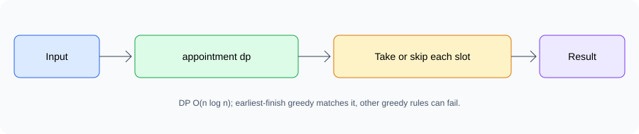

# Question 5 – Appointment dp

**Question:** Use dynamic programming to find the maximum number of appointments a doctor can attend in a shift given a set of overlapping time slots with different durations (greedy comparison expected).

## Files

- [appointment_scheduling_dp.py](appointment_scheduling_dp.py)
- [output.txt](output.txt) – console output
- [flowchart.svg](flowchart.svg) – steps of the solution

## How to run

```bash
python appointment_scheduling_dp.py
```

## Output

**python appointment_scheduling_dp.py**



## Approach



**Complexity:** DP O(n log n); earliest-finish greedy matches it, other greedy rules can fail.
